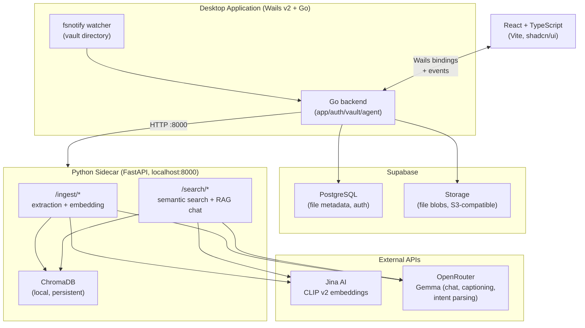
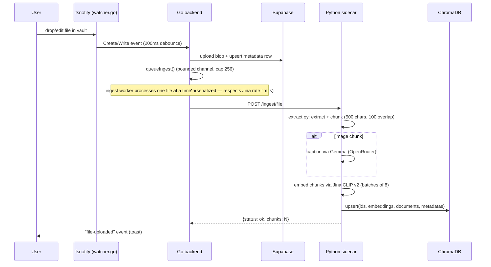
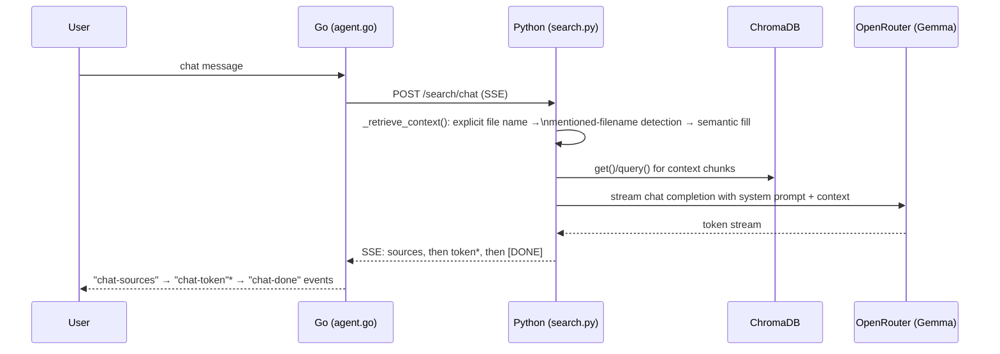
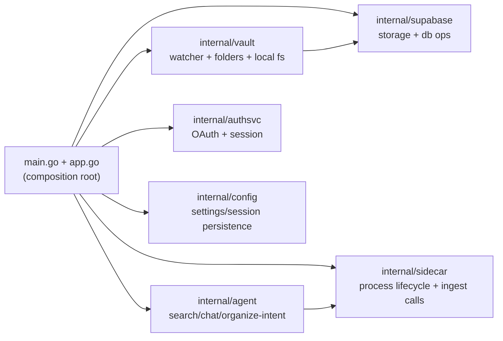
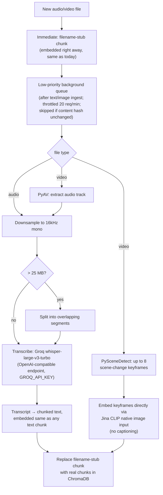
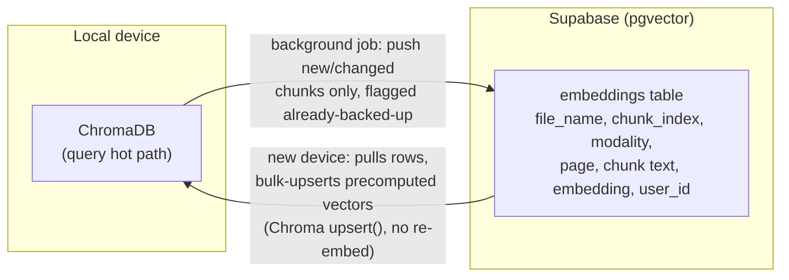

# Duckietown — Architecture

This document merges what used to be two separate root-level files —
`TECHNICAL_IMPLEMENTATION.md` (how the shipped system works today) and
`ARCHITECTURAL_BLUEPRINT.md` (the discussion draft that proposed a
restructure) — into one living architecture reference. The blueprint's open
questions have since been answered (see [Decision log](#decision-log)); this
file reflects that resolved direction and is kept up to date as the
restructure lands, instead of being frozen as a dated writeup.

## Table of contents

1. [System overview](#system-overview)
2. [Technology stack](#technology-stack)
3. [Current component layout](#current-component-layout)
4. [Data flow](#data-flow)
5. [NLP / embedding pipeline](#nlp--embedding-pipeline)
6. [Auth & session](#auth--session)
7. [Database schema](#database-schema)
8. [Decision log](#decision-log)
9. [Target architecture (post-restructure)](#target-architecture-post-restructure)
10. [Deferred / explicitly out of scope](#deferred--explicitly-out-of-scope)

---

## System overview

Duckietown is a desktop app (Wails v2 + Go) with a React/TypeScript frontend.
A Go backend owns the local vault, auth, and Supabase sync; a Python FastAPI
**sidecar** process (spawned by Go, not started manually) owns every AI/ML
workload — content extraction, embedding, and RAG chat.



The Go process spawns the sidecar itself (`sidecar.go`) once a user is
logged in and a vault folder is set.

---

## Technology stack

| Layer | Choice |
|---|---|
| Desktop shell | Wails v2 |
| Backend | Go — `net/http`, `fsnotify`, `godotenv` |
| Sidecar | Python — FastAPI + uvicorn |
| Vector store | ChromaDB (local, persistent, HNSW/cosine) |
| Embeddings | Jina CLIP v2 (1024-dim, joint text+image space) |
| LLM | Google Gemma 3 via OpenRouter (chat, captioning, intent parsing) |
| Content extraction | pdfplumber, python-docx, openpyxl, csv |
| Frontend | React 18 + TypeScript, Vite, shadcn/ui, TailwindCSS |
| Cloud | Supabase (Postgres metadata + Storage blobs + Google OAuth) |

Note on the original project pitch (`README.md`'s one-paragraph vision):
it mentions MongoDB and OCR/object-detection models. The shipped
implementation instead uses **Supabase** for both metadata and blob storage,
and uses **Gemma image captioning** (not OCR/object detection) as the image
understanding step. This document describes what's actually built.

---

## Current component layout

### Go backend (`duckietown/`) — `internal/*` packages + a slim composition root

The flat 13-file `package main` described in the original tech writeup has
been split per the [decision log](#decision-log) (#6). `*App` is now a thin
Wails-bound composition root that delegates every call straight down to a
service/client:

| Package | Sourced from | Owns |
|---|---|---|
| `internal/config` | `config.go`, `mime.go` | `Config`/`Session` persistence, `OpenPath`, `MimeType` |
| `internal/supabase` | `supabase.go`, `auth.go`'s Supabase REST calls | `Client` — Postgres REST CRUD, Storage upload/download/signed URLs, GoTrue auth calls (`GetUser`/`RefreshToken`/`Logout`), the shared `Do()` with 401-retry via an `OnUnauthorized` hook |
| `internal/sidecar` | `sidecar.go`, `ingest.go` | Python process lifecycle (`Start`/`Stop`, health check, port cleanup) + the ingest HTTP client (`IngestFile`/`MoveFileEmbeddings`/`DeleteFileEmbeddings`/`GetIndexedFiles`) |
| `internal/vault` | `watcher.go`, `folders.go`, `files.go`, `vault.go` | `Service` — fsnotify watch, folder hierarchy, file CRUD, ingest queue, `FullSync()`, vault-path management |
| `internal/agent` | `agent.go` | `Service` — semantic search, streaming chat, organize-intent parsing/execution (depends on `vault.Service` to search/move files) |
| `internal/authsvc` | `auth.go`'s OAuth flow | `Service` — Google OAuth (local callback server on :49155), session lifecycle, token refresh orchestration |
| `app.go` + `main.go` | — | Composition root: constructs one instance of each service, wires auth-state propagation (`OnAuthChange`/`OnSignOut`/`OnUnauthorized`), exposes the Wails-bound methods |

Dependency direction is one-way and acyclic: `config` and `supabase` are
leaves; `vault` depends on `config` + `supabase` + `sidecar`; `authsvc`
depends on `config` + `supabase`; `agent` depends on `vault` + `sidecar`.
Frontend-facing method names, parameter types, and JSON shapes are
unchanged — verified by regenerating `frontend/wailsjs/*` with
`wails generate module` and diffing (the only real change was the removal
of four methods — `GetIndexedFiles`, `IngestFile`, `MoveFileEmbeddings`,
`DeleteFileEmbeddings` — that were never called from the frontend to begin
with; they're sidecar-internal now, reached through `vault.Service.Sidecar`
rather than being Wails-bound).

### Python sidecar (`duckietown/sidecar/`)

| File | Responsibility |
|---|---|
| `main.py` | FastAPI app, CORS, router wiring, `/health` |
| `extract.py` | Per-file-type content extraction + fixed-window chunking |
| `ingest.py` | Captioning, Jina embedding calls, ChromaDB upsert/move/delete |
| `search.py` | Semantic search, type-filtered search, RAG chat (SSE), organize-intent parsing |

### Frontend (`duckietown/frontend/src/`)

```
App.tsx                  screen state machine: loading → auth → setup → main
components/
  authscreen.tsx          Google OAuth sign-in
  setupscreen.tsx         vault folder picker
  mainscreen.tsx          main file browser shell
  filearea.tsx            file grid/list
  foldertree.tsx          folder navigation
  sidebar.tsx             nav sidebar
  topbar.tsx              top bar (sync status, etc.)
  searchbar.tsx           search input
  aipanel.tsx             AI chat panel
  ui/                     shadcn/ui primitives
lib/
  wails.ts                Wails runtime wrapper
  utils.ts
types.ts
```

---

## Data flow

### Ingestion (file created/modified → searchable)



### Search

```mermaid
sequenceDiagram
    participant User
    participant Go as Go (agent.go)
    participant Sidecar as Python (search.py)
    participant Chroma as ChromaDB

    User->>Go: search query
    Go->>Sidecar: POST /search/query {query, top_k, type_filter?}
    Sidecar->>Sidecar: embed query (Jina CLIP v2)
    Sidecar->>Chroma: query(embedding, n_results)
    Chroma-->>Sidecar: chunks + cosine distances
    Sidecar->>Sidecar: similarity = 1 - distance/2; dedupe by file; threshold 0.7 (fallback top 3)
    Sidecar-->>Go: ranked results + snippets
    Go-->>User: results list
```

### Chat (RAG)



### Move / delete

Renames and moves reuse existing embeddings (`PATCH /ingest/move` rewrites
IDs + metadata without re-embedding); deletes cascade through local FS →
Supabase Storage → Postgres row → ChromaDB chunks.

---

## NLP / embedding pipeline

```
Raw file → extract.py (per-type extraction) → fixed-window chunking
         → [image chunks only] Gemma captioning (OpenRouter)
         → Jina CLIP v2 embedding (batched, retried w/ backoff)
         → ChromaDB upsert (per-user collection, HNSW/cosine)
```

- **Chunking**: fixed 500-char windows, 100-char overlap. No structure
  awareness (can cut mid-sentence or mid-table-row).
- **Images**: captioned via Gemma, caption embedded as text. Jina CLIP v2's
  native image-embedding input is *not* currently used, despite one
  docstring implying it is.
- **Audio/video**: `extract_audio`/`extract_video` return a single stub
  chunk (`"Audio recording: {name}"`) embedded as text — there is no real
  transcription or visual analysis today. Search over audio/video content is
  effectively filename search. See [target architecture](#audio--video-real-content-extraction)
  for the planned fix.
- **Rate limiting**: Jina calls batched 8-at-a-time, 0.5s between batches,
  exponential backoff (2s→32s, 5 retries) honoring `Retry-After`.

---

## Auth & session

Google OAuth via Supabase Auth. `auth.go` binds a local callback server on
`:49155`, opens the Supabase `/authorize` URL in the system browser, and
that redirect URL must be registered in Supabase under
Authentication → URL Configuration. Tokens are POSTed back to a local
`/token` handler, stored in `%AppData%/duckietown/session.json` (0600), and
refreshed automatically on 401 (single retry).

---

## Database schema

```sql
CREATE TABLE files (
    id UUID DEFAULT gen_random_uuid() PRIMARY KEY,
    user_id UUID NOT NULL,
    name TEXT NOT NULL,
    size BIGINT NOT NULL,
    mime_type TEXT NOT NULL,
    storage_path TEXT NOT NULL,
    folder_path TEXT DEFAULT '',
    created_at TIMESTAMPTZ DEFAULT NOW(),
    updated_at TIMESTAMPTZ DEFAULT NOW(),
    UNIQUE(user_id, name)
);
```

Storage objects live under `duckietown/{user_id}/{folder_path}/{file}` in the
`duckietown` bucket. ChromaDB collections are named `user_<user_id>` — one
collection per user, entirely local, never queried over the network in the
hot path.

---

## Decision log

`ARCHITECTURAL_BLUEPRINT.md` was deliberately a discussion draft ("not a
decision document... the actual workflow/implementation plan comes after
this is settled"). These are the answers that unblocked the restructure:

| # | Question | Resolution |
|---|---|---|
| 1 | Local ChromaDB vs. querying Supabase/pgvector directly? | **Settled (pre-existing):** ChromaDB stays the only thing searches hit. A background job backs up embeddings to a `pgvector`-enabled Supabase table so a new device restores precomputed vectors instead of re-embedding. pgvector never sits in the query hot path. |
| 2 | Python sidecar + LangChain/LangGraph, or Go-native rewrite? | **Keep the Python sidecar.** This is the load-bearing decision the rest follow from. Adopt LangChain's `Chroma` retriever wrapper incrementally (next time retrieval code is touched). Bring in LangGraph specifically for the organize flow's confirm-before-move step: `parse intent → search → confirm → create folder → move → report`. Invest in finishing the PyInstaller packaging path already stubbed in `sidecar.go` rather than abandoning Python to dodge packaging. |
| 3 | Multi-device use: real/near-term or hypothetical? | Not blocking — the Supabase-backup shape (#1) is correct either way; this only affects how soon it's prioritized. |
| 4 | How much more "agent" surface (rename, dedup, tagging, multi-step research)? | Not blocking for this pass — the organize confirm-step is already a concrete, sufficient trigger for LangGraph adoption; broader agent surface is a later call. |
| 5 | Audio/video content search — needed soon, or filename-only acceptable? | **Add real extraction, optimized for speed.** See [below](#audio--video-real-content-extraction) for the full design. |
| 6 | Go package refactor — this pass, or deferred? | **This pass — done.** Split the flat `package main` into `internal/*` packages (see below). |
| 7 | Self-hosting productization (setup wizard, BYO-key UI, installers)? | **Deferred — no concrete deadline/audience.** Publishing the code openly is still fine (the `.env.local`/`.env.example` pattern already supports BYO Supabase/Jina/OpenRouter keys for a clone); the setup-wizard/BYO-key-UI work itself is out of scope for this pass. |

---

## Target architecture (post-restructure)

### Go package split — done

Go packages are directory-based 1:1, so this was a real refactor (not a
file move) — it forced the implicit `a.userID`/`a.vaultPath`/`a.ctx` access
pattern on `*App` into explicit per-domain state passed between packages.
See [current component layout](#current-component-layout) for the landed
shape; the diagram below is what was actually built.



| Package | Sourced from |
|---|---|
| `internal/supabase` | `supabase.go` |
| `internal/vault` | `watcher.go`, `folders.go`, `files.go`, `vault.go` |
| `internal/sidecar` | `sidecar.go`, `ingest.go` |
| `internal/agent` | `agent.go` |
| `internal/authsvc` | `auth.go` |
| `internal/config` | `config.go`, `mime.go` |

`main.go` + a slim `app.go` remain the composition root: hold instances of
each package's client/service type, expose Wails-bound methods, delegate
down.

### Sidecar: LangChain / LangGraph adoption

- **Retrieval**: replace hand-rolled `collection.query()` + manual
  dedupe/threshold logic in `search.py` with LangChain's `Chroma` retriever
  wrapper as the retrieval code is next touched.
- **Organize flow**: model as a LangGraph state machine —
  `parse intent → search → confirm → create folder → move → report` — adding
  the preview/confirm step ("found 14 files matching X, move to Y?") that's
  currently missing entirely (a vague prompt today is parsed once and
  executed immediately against potentially dozens of files).
- **Model choice for intent parsing**: switch from the faster/smaller model
  to the bigger one — accuracy should win over latency here, since this
  runs once per request, not per streamed token.

### Retrieval accuracy levers (priority order)

1. **Structure-aware chunking** — split on paragraph/section boundaries,
   keep headers attached to content, instead of fixed 500/100 windows.
2. **Hybrid search** — combine dense/cosine with lexical/BM25, merge
   results. Catches exact terms (names, codes, acronyms) pure vector search
   misses.
3. **Reranking** — pull a wider top-k, rerank, then apply the similarity
   threshold.
4. **Query expansion** — 2-3 paraphrases for vague queries, merge results.
   Directly helps the organize flow's vague-prompt problem, since it shares
   this search path.
5. **Embedding model swap** — last resort only. Jina CLIP v2's joint
   text+image space is why one search bar returns both a PDF and a photo for
   the same query; a text-only model would likely beat it on pure text
   retrieval but breaks that joint comparability unless two indices are
   maintained and merged.

### Images: native CLIP embedding as a second chunk

Add native CLIP image-embedding as a *second* chunk alongside the existing
caption (not a replacement). The caption stays for human-readable snippets
and named entities; the native image embedding catches visual content the
caption omitted.

### Audio / video real content extraction



Design notes:
- Transcription lives behind one function so a local `faster-whisper`
  fallback can be added later without touching call sites.
- The filename stub ships immediately (same as today); the real
  transcription/keyframe work happens asynchronously so ingest latency for
  other files is unaffected.
- Throttled to 20 requests/min and skipped when the content hash hasn't
  changed, so re-syncs don't re-transcribe unchanged files.
- New env var: `GROQ_API_KEY`.
- New Python deps: `groq` (or plain `requests` against the OpenAI-compatible
  endpoint), `av` (PyAV), `scenedetect` (PySceneDetect).

### Supabase backup/restore (pgvector)



pgvector is backup/restore only — it never sits in the query hot path, so it
doesn't reintroduce the network-latency problem that ruled out querying
Supabase directly in the first place. Storage cost is a non-issue at this
scale (a 1024-dim vector ≈ 4KB).

### Organize flow with confirmation

```
parse intent (bigger model) → semantic search (type-filtered) →
confirm ("found N files matching X, move to Y?") → create folder →
move files → report
```

### Other independent fixes

- **Indexing progress bar**: already free. `ingest-queued` gives total file
  count, `ingest-progress` gives remaining count after each file —
  `percent = (total - remaining) / total`. Pure frontend wiring into
  `topbar.tsx`, no backend change needed.
- **UI responsiveness for variable-length/odd text**: needs an actual read
  of `filearea.tsx` / `searchbar.tsx` / `aipanel.tsx` rather than guessing
  the cause up front. General levers that usually apply: fluid sizing over
  fixed containers, `overflow-wrap`/`word-break` for long unbroken tokens,
  truncate-with-expand for long snippets, virtualized lists for long result
  sets.

---

## Deferred / explicitly out of scope

- Self-hosting productization: first-run setup wizard, BYO-key UI for all
  three external services (OpenRouter, Jina, Supabase), cross-platform
  installers for strangers. Publishing the code openly is not blocked by
  this.
- MCP server exposure (Duckietown's search/organize as an MCP server for
  Claude Desktop etc.) — worth keeping on the list if self-hosting ever
  becomes a real goal, not needed now.
- A2A — no identified need; Duckietown has one cohesive internal agent, not
  multiple independently-deployed agents to coordinate with.
- Broader "agent surface" beyond the organize confirm-step (rename, dedup,
  tagging, multi-step research) — revisit once the confirm-step work lands.
