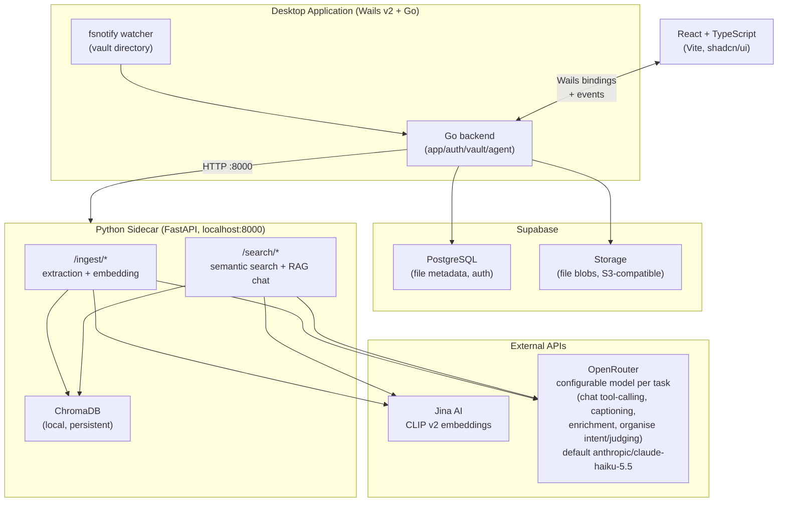
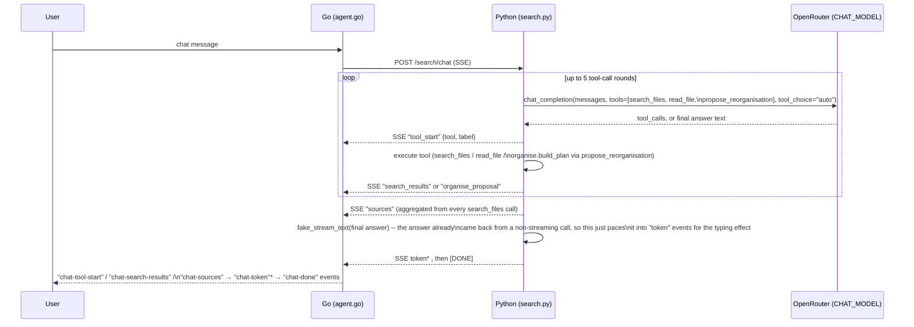
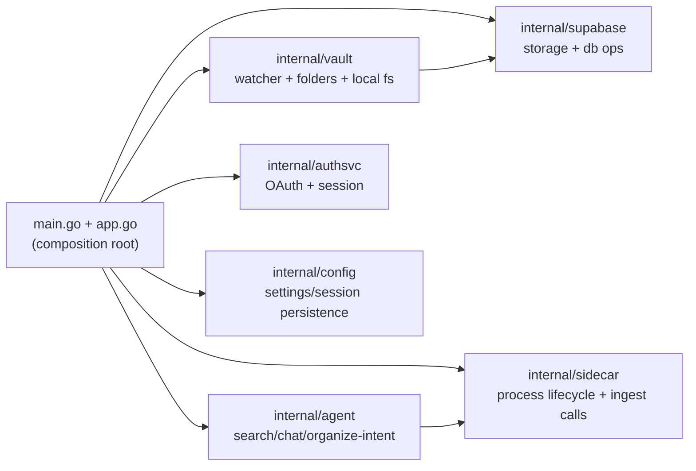
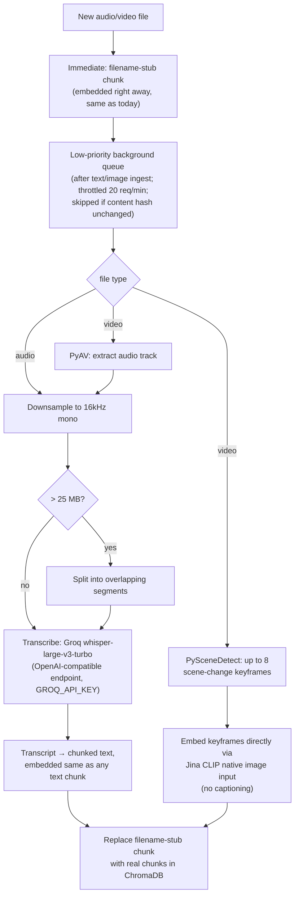
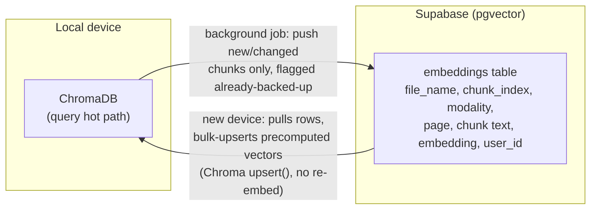

# Duckietown — Architecture

This document merges what used to be two separate root-level files —
`TECHNICAL_IMPLEMENTATION.md` (how the shipped system works today) and
`ARCHITECTURAL_BLUEPRINT.md` (the discussion draft that proposed a
restructure) — into one living architecture reference. The blueprint's open
questions have since been answered (see [Decision log](#decision-log)); this
file reflects that resolved direction and is kept up to date as the
restructure lands, instead of being frozen as a dated writeup.

## Table of contents

1. [System overview](#system-overview)
2. [Technology stack](#technology-stack)
3. [Current component layout](#current-component-layout)
4. [Data flow](#data-flow)
5. [NLP / embedding pipeline](#nlp--embedding-pipeline)
6. [Auth & session](#auth--session)
7. [Windows Explorer integration](#windows-explorer-integration)
8. [Database schema](#database-schema)
9. [Decision log](#decision-log)
10. [Target architecture (post-restructure)](#target-architecture-post-restructure)
11. [Deferred / explicitly out of scope](#deferred--explicitly-out-of-scope)

---

## System overview

Duckietown is a desktop app (Wails v2 + Go) with a React/TypeScript frontend.
A Go backend owns the local vault, auth, and Supabase sync; a Python FastAPI
**sidecar** process (spawned by Go, not started manually) owns every AI/ML
workload — content extraction, embedding, and RAG chat.



The Go process spawns the sidecar itself (`sidecar.go`) once a user is
logged in and a vault folder is set.

---

## Technology stack

| Layer | Choice |
|---|---|
| Desktop shell | Wails v2 |
| Backend | Go — `net/http`, `fsnotify`, `godotenv` |
| Sidecar | Python — FastAPI + uvicorn |
| Vector store | ChromaDB (local, persistent, HNSW/cosine) |
| Embeddings | Jina CLIP v2 (1024-dim, joint text+image space) |
| LLM | Configurable via OpenRouter — `CHAT_MODEL`/`INTENT_MODEL`/`CAPTION_MODEL`/`ENRICH_MODEL` env vars, each defaulting to `anthropic/claude-haiku-5.5`; `OPENROUTER_MODEL` is a deprecated alias for `CHAT_MODEL` |
| Content extraction | pdfplumber, python-docx, openpyxl, csv |
| Frontend | React 18 + TypeScript, Vite, shadcn/ui, TailwindCSS |
| Cloud | Supabase (Postgres metadata + Storage blobs + Google OAuth) |

Note on the original project pitch (`README.md`'s one-paragraph vision):
it mentions MongoDB and OCR/object-detection models. The shipped
implementation instead uses **Supabase** for both metadata and blob storage,
and uses **LLM image captioning** (not OCR/object detection) as the image
understanding step. This document describes what's actually built.

---

## Current component layout

### Go backend (`duckietown/`) — `internal/*` packages + a slim composition root

The flat 13-file `package main` described in the original tech writeup has
been split per the [decision log](#decision-log) (#6). `*App` is now a thin
Wails-bound composition root that delegates every call straight down to a
service/client:

| Package | Sourced from | Owns |
|---|---|---|
| `internal/config` | `config.go`, `mime.go` | `Config`/`Session` persistence, `OpenPath`, `MimeType` |
| `internal/supabase` | `supabase.go`, `auth.go`'s Supabase REST calls | `Client` — Postgres REST CRUD, Storage upload/download/signed URLs, GoTrue auth calls (`GetUser`/`RefreshToken`/`Logout`), the shared `Do()` with 401-retry via an `OnUnauthorized` hook |
| `internal/sidecar` | `sidecar.go`, `ingest.go` | Python process lifecycle (`Start`/`Stop`, health check, port cleanup) + the ingest HTTP client (`IngestFile`/`MoveFileEmbeddings`/`DeleteFileEmbeddings`/`GetIndexedFiles`) |
| `internal/vault` | `watcher.go`, `folders.go`, `files.go`, `vault.go` | `Service` — fsnotify watch, folder hierarchy, file CRUD, ingest queue, `FullSync()`, vault-path management |
| `internal/agent` | `agent.go`, `organise_plan.go`, `rename_plan.go`, `plan_store.go` | `Service` — semantic search, streaming chat, organise and rename plan building/confirm/cancel (depends on `vault.Service` to search/move/rename files) |
| `internal/authsvc` | `auth.go`'s OAuth flow, `porterr_windows.go`/`porterr_other.go`'s bind-error classification | `Service` — Google OAuth (local callback server on 127.0.0.1, trying ports 47155/47156/47157 in order), session lifecycle, token refresh orchestration |
| `internal/shell` | `shell_windows.go` (`//go:build windows`) + `shell_other.go` (no-op stub) | Windows-only Explorer integration: custom vault folder icon (`desktop.ini` + attributes) and a pinned nav-pane entry (HKCU registry), no admin rights |
| `app.go` + `main.go` | — | Composition root: constructs one instance of each service, wires auth-state propagation (`OnAuthChange`/`OnSignOut`/`OnUnauthorized`), exposes the Wails-bound methods |

Dependency direction is one-way and acyclic: `config` and `supabase` are
leaves; `vault` depends on `config` + `supabase` + `sidecar`; `authsvc`
depends on `config` + `supabase`; `agent` depends on `vault` + `sidecar`.
Frontend-facing method names, parameter types, and JSON shapes are
unchanged — verified by regenerating `frontend/wailsjs/*` with
`wails generate module` and diffing (the only real change was the removal
of four methods — `GetIndexedFiles`, `IngestFile`, `MoveFileEmbeddings`,
`DeleteFileEmbeddings` — that were never called from the frontend to begin
with; they're sidecar-internal now, reached through `vault.Service.Sidecar`
rather than being Wails-bound).

### Python sidecar (`duckietown/sidecar/`)

| File | Responsibility |
|---|---|
| `main.py` | FastAPI app, CORS, router wiring, `/health` |
| `config.py` | All env/constants (model names, API keys, Chroma/cache dirs) — the only module that reads `os.environ`; every other module imports from this one |
| `openrouter_client.py` | The one shared OpenRouter client: `chat_completion()` (retry/backoff on 429/5xx, honors `Retry-After`), `vision_caption()`, `fake_stream_text()` for the chat SSE typing effect |
| `jina_client.py` | Jina CLIP v2 embedding calls (batch + single-query) |
| `chroma_store.py` | The ChromaDB `PersistentClient` singleton + per-user collection accessor |
| `extract.py` | Per-file-type content extraction + fixed-window chunking |
| `enrich.py` | File-profile generation (summary/category/keywords) via `ENRICH_MODEL`, plus the SHA-256 content-hash cache (`<cache dir>/file_profiles.json`) that makes resyncs/renames/moves free of repeat caption/enrichment calls |
| `retrieval.py` | `search_files()` — the one retrieval path shared by `/search/query`, chat's tool loop, and organise's wide search |
| `organise.py` | Organise intent parsing, candidate judging, and plan building (search → judge → plan) — pure computation, no state |
| `rename.py` | Rename intent parsing, name proposal, and plan building (search → propose names → plan) — mirrors `organise.py`'s shape, pure computation, no state |
| `json_utils.py` | `strip_json_fences()` — shared by `organise.py` and `rename.py` for stripping markdown fences off a model's JSON response |
| `ingest.py` | Extraction → caption → enrich → embed → ChromaDB upsert/move/delete, plus the profile backfill endpoint |
| `search.py` | `/search/query` (thin wrapper over `search_files`), tool-calling RAG chat (SSE), `/search/organise-plan` |

### Frontend (`duckietown/frontend/src/`)

```
App.tsx                  screen state machine: loading → auth → setup → main
components/
  authscreen.tsx          Google OAuth sign-in
  setupscreen.tsx         vault folder picker
  mainscreen.tsx          main file browser shell
  filearea.tsx            file grid/list
  foldertree.tsx          folder navigation
  sidebar.tsx             nav sidebar
  topbar.tsx              top bar (sync status, etc.)
  searchbar.tsx           search input
  aipanel.tsx             AI chat panel
  ui/                     shadcn/ui primitives
lib/
  wails.ts                Wails runtime wrapper
  utils.ts
types.ts
```

---

## Data flow

### Ingestion (file created/modified → searchable)

```mermaid
sequenceDiagram
    participant User
    participant Watcher as fsnotify (watcher.go)
    participant Go as Go backend
    participant Supa as Supabase
    participant Sidecar as Python sidecar
    participant Chroma as ChromaDB

    User->>Watcher: drop/edit file in vault
    Watcher->>Go: Create/Write event (200ms debounce)
    Go->>Supa: upload blob + upsert metadata row
    Go->>Go: queueIngest() (bounded channel, cap 256)
    Note over Go: ingest worker processes one file at a time\n(serialized — respects Jina rate limits)
    Go->>Sidecar: POST /ingest/file {..., folder_path}
    Sidecar->>Sidecar: extract.py: extract + chunk (500 chars, 100 overlap)
    Sidecar->>Sidecar: enrich.py: SHA-256 of file bytes -> cache lookup
    alt image chunk
        Sidecar->>Sidecar: caption via CAPTION_MODEL (cache hit skips the call)
    end
    alt text-bearing or image (cache miss)
        Sidecar->>Sidecar: build_profile() via ENRICH_MODEL -> {summary, category, keywords}
        Sidecar->>Sidecar: cache profile by content hash
    end
    Sidecar->>Sidecar: embed content chunks + 1 profile chunk via Jina CLIP v2 (batches of 8)
    Sidecar->>Chroma: upsert(ids, embeddings, documents, metadatas)\n(content chunks: chunk_type="content" + summary/category;\none chunk_type="profile" chunk per file)
    Sidecar-->>Go: {status: ok, chunks: N, profiled: bool}
    Go-->>User: "file-uploaded" event (toast)
```

Enrichment never blocks or fails ingest: a failed `ENRICH_MODEL` call is
logged and the file is still indexed without a profile (just content
chunks). Both the caption and the profile are cached by SHA-256 of the
file's bytes in `<cache dir>/file_profiles.json`, so a resync, rename, or
move of unchanged content makes zero new OpenRouter calls. Files indexed
before enrichment existed don't get a profile automatically — the
`BackfillFileProfiles` Wails method (a small icon button in the AI panel
header) generates profiles for them from already-indexed chunks, no
re-extraction or re-embedding needed (`POST /ingest/enrich`).

### Search — the one retrieval path

```mermaid
sequenceDiagram
    participant Caller as /search/query, chat's search_files tool,\nor organise's wide search
    participant Sidecar as retrieval.py: search_files()
    participant Chroma as ChromaDB

    Caller->>Sidecar: search_files(query, type_filter?, folder?, top_k, min_score?)
    Sidecar->>Sidecar: embed query (Jina CLIP v2)
    Sidecar->>Chroma: query(embedding, n_results, where={modality?, folder_path?})
    Chroma-->>Sidecar: chunks (content AND profile) + cosine distances
    Sidecar->>Sidecar: similarity = 1 - distance/2; dedupe by file\n(content chunk -> snippet, profile chunk -> score only)
    Sidecar->>Sidecar: explicit-filename match folded in (not a parallel path)
    Sidecar-->>Caller: per file: name, folder_path, mime_type, snippet,\nprofile summary, category, score
```

`/search/query` is now a thin wrapper over `search_files` — same request/
response shape as before, with `score`/`folder_path`/`mime_type`/`summary`/
`category` added. The old duplicate retrieval logic in chat
(`_retrieve_context`) and organise (`semanticSearchWithTypeFilter` + a raw
vault scan) is gone; both now call `search_files` too.

### Chat — tool-calling RAG



The system prompt requires the model to answer only from tool results, cite
the file names it used, never invent files, and never claim a file was
moved — `propose_reorganisation` only ever builds a preview (see below); it
moves nothing, and existing `chat-sources`/`chat-token`/`chat-done` events
keep working unchanged.

### Organise — search wide → judge → preview → confirm → move

```mermaid
sequenceDiagram
    participant User
    participant Frontend as aipanel.tsx
    participant Go as Go (agent.go)
    participant Sidecar as Python (organise.py)

    User->>Frontend: "put all my legal stuff in one folder"
    Frontend->>Go: via chat's propose_reorganisation tool,\nor ProposeOrganise(message, currentFolder) directly
    Go->>Sidecar: POST /search/organise-plan
    Sidecar->>Sidecar: parse_intent() via INTENT_MODEL
    alt instruction too vague ("organise everything")
        Sidecar-->>Go: {needs_clarification: true, proposed_groupings: [...]}
        Go-->>Frontend: "organise-clarification" event -> 2-4 buttons
        Frontend->>Go: user picks one -> ProposeOrganise again with that instruction
    else specific enough to act on
        Sidecar->>Sidecar: search_files(query, type_filter?, top_k=30, no threshold)
        Sidecar->>Sidecar: judge candidates via INTENT_MODEL -> matches + reasons\n(strict JSON, validated, retried once on bad output)
        Sidecar-->>Go: {target_folder, moves: [{file_name, folder_path, reason}]}
        Go->>Go: register pending plan in memory (10 min TTL)
        Go-->>Frontend: "organise-plan-ready" event
        Frontend-->>User: "Move N files to <folder>?" preview,\nper-file reason + checkbox (default all checked)
        User->>Frontend: Confirm (optionally unchecking some files)
        Frontend->>Go: ConfirmOrganisePlan(planID, selectedFileNames)
        Go->>Go: sanitize target path; create folder;\nfor each selected file: resolve current location,\nrename-on-collision, then MoveFileToFolder (existing path, no re-embed)
        Go-->>Frontend: "organise-complete" event + per-file failures
    end
```

Nothing moves before `ConfirmOrganisePlan` is called, and only the files
the user left checked are moved; `CancelOrganisePlan` just discards the
pending plan. Target folder names are sanitized (`SanitizeRelativeFolderPath`
in `internal/vault/folders.go`) — absolute paths and `..` segments are
rejected — so a model-produced folder name can't escape the vault root.

### Rename — search wide → propose names → preview → confirm → rename

```mermaid
sequenceDiagram
    participant User
    participant Frontend as aipanel.tsx
    participant Go as Go (agent.go)
    participant Sidecar as Python (rename.py)

    User->>Frontend: "give my screenshots descriptive names"
    Frontend->>Go: via chat's propose_rename tool
    Go->>Sidecar: (inside /search/chat's tool loop)
    Sidecar->>Sidecar: parse_rename_intent() via INTENT_MODEL
    Sidecar->>Sidecar: search_files(query, type_filter?, top_k=30, no threshold)
    Sidecar->>Sidecar: propose new names per candidate via INTENT_MODEL\n(retry once on bad JSON)
    Sidecar-->>Go: SSE "rename_proposal" {renames: [{file_name, folder_path, old_name, new_name, reason}]}
    Go->>Go: sanitize every new_name (SanitizeFileName — never trust raw model output);\nrestore an extension the model omitted; flag a genuinely changed one
    Go->>Go: resolve collisions within the batch AND vault-wide\n(FileExistsAnywhereInVault, not folder-scoped — see note below)
    Go->>Go: register pending plan in memory (10 min TTL, same mechanics as organise)
    Go-->>Frontend: "rename-plan-ready" event
    Frontend-->>User: old name -> new name per row, inline-editable,\ncheckbox (default all checked), ⚠ if extension changes
    User->>Frontend: Confirm (optionally editing names / unchecking rows)
    Frontend->>Go: ConfirmRenamePlan(planID, selections)
    Go->>Go: re-sanitize + re-collision-check any edited name
    Go->>Go: for each selected file, vault.RenameFile\n(existing path: local FS -> Supabase -> ChromaDB, no re-embed)
    Go-->>Frontend: "rename-complete" event + per-file failures
```

Rename has no separate "ask which one" code path for an ambiguous
single-file reference — it relies on the same chat system-prompt
instruction organise does ("ask which one instead of guessing"), applied
before the model ever decides to call `propose_rename`. It also has no
"too vague" branch like organise's proposed-groupings — not requested for
rename, and a chat-only tool with no direct (non-chat) entry point.

The collision check must be **vault-wide**, not folder-scoped: Supabase's
`files` table enforces `UNIQUE(user_id, name)` across the whole vault, not
per folder (see [Database schema](#database-schema)) — a same-folder-only
check could let a rename look collision-free locally while silently
desyncing Supabase.

### Move / delete

Renames and moves reuse existing embeddings (`PATCH /ingest/move` rewrites
IDs + metadata, including `folder_path`, without re-embedding); deletes
cascade through local FS → Supabase Storage → Postgres row → ChromaDB
chunks.

---

## NLP / embedding pipeline

```
Raw file → extract.py (per-type extraction) → fixed-window chunking
         → [image chunks only] captioning via CAPTION_MODEL (cached by content hash)
         → [text-bearing or image] file-profile via ENRICH_MODEL (cached by content hash)
         → Jina CLIP v2 embedding: content chunks + 1 profile chunk (batched, retried w/ backoff)
         → ChromaDB upsert (per-user collection, HNSW/cosine)
```

- **Chunking**: fixed 500-char windows, 100-char overlap. No structure
  awareness (can cut mid-sentence or mid-table-row).
- **File profiles**: every text-bearing file (pdf/docx/xlsx/csv/txt/md) and
  every image (via its caption) gets one extra "profile" chunk — a 2-3
  sentence summary, a category label, and keywords/entities, generated by
  `ENRICH_MODEL`. The profile is embedded as its own searchable chunk
  (`chunk_type="profile"`) AND duplicated onto every content chunk's
  metadata (`summary`/`category`), so search results and chat can show it
  without another LLM call. This is what lets a vague query like "legal
  stuff" match a file with no "legal" in its name.
- **Images**: captioned via `CAPTION_MODEL`, caption embedded as text. Jina
  CLIP v2's native image-embedding input is *not* currently used, despite
  one docstring implying it is (see [target architecture](#images-native-clip-embedding-as-a-second-chunk)).
- **Audio/video**: `extract_audio`/`extract_video` return a single stub
  chunk (`"Audio recording: {name}"`) embedded as text — there is no real
  transcription or visual analysis today. Search over audio/video content is
  effectively filename search. See [target architecture](#audio--video-real-content-extraction)
  for the planned fix.
- **Rate limiting**: Jina calls batched 8-at-a-time, 0.5s between batches,
  exponential backoff (2s→32s, 5 retries) honoring `Retry-After`.

---

## Auth & session

Google OAuth via Supabase Auth. `auth.go` binds a local callback server to
`127.0.0.1`, trying candidate ports `47155`, `47156`, `47157` in order and
using the first that binds (kept below Windows' dynamic/ephemeral port
range 49152-65535, which Hyper-V/WSL2/Docker can partially reserve), then
opens the Supabase `/authorize` URL — built from whichever port actually
bound, logged at startup alongside the bound address so a host/port
mismatch between the two is visible immediately — in the system browser.
Every one of those ports' redirect URLs must be registered in Supabase
under Authentication → URL Configuration → Redirect URLs, *and* the Site
URL there must point at one of them: if `redirect_to` isn't in that
allowlist, Supabase silently redirects to the Site URL instead, which
lands the browser on a port nothing is listening on (see README.md).
A second `SignInWithGoogle` call (retry, double-click) cancels any
still-listening previous attempt before binding again; the server also
shuts itself down on success, on error, or after a 5-minute timeout.
Bind failures are classified via `porterr_windows.go`/`porterr_other.go`
(real WSAEACCES/WSAEADDRINUSE codes on Windows, plain errno elsewhere) so
a Windows-reserved-port failure isn't misreported as "already in use".
Tokens are POSTed back to a local `/token` handler, stored in
`%AppData%/duckietown/session.json` (0600), and refreshed automatically on
401 (single retry).

---

## Windows Explorer integration

`internal/shell` (Windows-only via `//go:build windows`, a no-op stub
everywhere else) makes the vault folder feel native in Explorer — a
custom folder icon and a OneDrive-style pinned entry in the navigation
pane — entirely under `HKCU`, no admin rights, no UAC prompt.

```go
func EnsureIcon() (string, error)                    // copies the embedded icon to a stable path, idempotent (hash compare)
func RegisterVaultFolder(vaultPath string) error      // icon + desktop.ini + attrs + nav-pane pin + SHChangeNotify, idempotent
func MoveVaultFolder(oldPath, newPath string) error   // cleans up oldPath's setup, then RegisterVaultFolder(newPath)
func Remove(vaultPath string) error                   // undoes everything
```

**Stable icon**: the embedded `.ico` is copied to
`%LOCALAPPDATA%\Duckietown\icons\duckietown-folder.ico` once (content-hash
compared on every call, so it's never rewritten unless it actually
changed) — every registry value and `desktop.ini` entry points at this
fixed path, never a dev/build temp path.

**Folder icon**: writes `<vault>\desktop.ini` with an `IconResource` line
under `[.ShellClassInfo]`, preserving any other content a different tool
may have written (backs up the original once, to
`<vault>\.duckietown-desktop-ini.bak`, before first touching it; restores
from that backup on `Remove` instead of guessing what to undo). Sets
`desktop.ini`'s attributes to hidden+system, and sets the vault
directory's `READONLY` attribute — Explorer's documented (and only)
trigger to read a folder's `desktop.ini`; it does **not** restrict writes
inside the directory. `desktop.ini` is excluded from sync/ingest at a
single point of control: `shouldSkipFile()` in `internal/vault/watcher.go`
gates every WalkDir/fsnotify path that feeds Supabase upload or ChromaDB
ingest, so one case there (case-insensitive match) is sufficient.

**Nav-pane pin**: registers Microsoft's documented "Integrate a Cloud
Storage Provider" shell-namespace schema under a single, fixed CLSID
(`{06EFE274-766E-42D6-B205-32B17E9A442B}`, generated once, hardcoded
forever) — `Software\Classes\CLSID\{GUID}` (+ `DefaultIcon`,
`InProcServer32`, `Instance`, `Instance\InitPropertyBag`, `ShellFolder`
subkeys with the exact values Microsoft's doc specifies),
`...\Explorer\Desktop\NameSpace\{GUID}`, and one DWORD value named after
the GUID under `...\Explorer\HideDesktopIcons\NewStartPanel` (so it
doesn't also show as a desktop icon) — followed by `SHChangeNotify`.
Removal deletes the whole `CLSID\{GUID}` subtree and the `NameSpace`
entry, but only the one `{GUID}`-named *value* under
`HideDesktopIcons\NewStartPanel`, never that key itself — it holds other
apps' (e.g. OneDrive's) unrelated entries too. Known caveat, not a bug:
nav-pane root re-enumeration sometimes still needs an Explorer restart or
sign-out despite `SHChangeNotify`, on some Windows builds.

**Lifecycle**: registered on `SetVaultPath` and idempotently on every
startup with an existing vault (`app.go`). `Config.DisableExplorerIntegration`
(default `false` = enabled) persists the user's choice, exposed as a
small icon-button toggle in the sidebar footer ("Show in File Explorer")
and as the standalone `RemoveExplorerIntegration` Wails method. Every
registry/file-attribute call runs in a background goroutine and only ever
logs on failure — the app works with zero shell integration if any of it
fails (locked file, no registry access, whatever).

**Manual dev cleanup** (normally unnecessary — use the toggle, or
`RemoveExplorerIntegration`):
```
HKCU\Software\Classes\CLSID\{06EFE274-766E-42D6-B205-32B17E9A442B}                                            — delete entire subtree
HKCU\Software\Microsoft\Windows\CurrentVersion\Explorer\Desktop\NameSpace\{06EFE274-766E-42D6-B205-32B17E9A442B} — delete key
HKCU\Software\Microsoft\Windows\CurrentVersion\Explorer\HideDesktopIcons\NewStartPanel                        — delete ONLY the {06EFE274-766E-42D6-B205-32B17E9A442B} value, not the key
```
Plus, by hand if needed: delete `<vault>\desktop.ini` and
`<vault>\.duckietown-desktop-ini.bak`, `attrib -r "<vault>"` to clear the
read-only attribute, and optionally delete
`%LOCALAPPDATA%\Duckietown\icons\duckietown-folder.ico`.

---

## Database schema

```sql
CREATE TABLE files (
    id UUID DEFAULT gen_random_uuid() PRIMARY KEY,
    user_id UUID NOT NULL,
    name TEXT NOT NULL,
    size BIGINT NOT NULL,
    mime_type TEXT NOT NULL,
    storage_path TEXT NOT NULL,
    folder_path TEXT DEFAULT '',
    created_at TIMESTAMPTZ DEFAULT NOW(),
    updated_at TIMESTAMPTZ DEFAULT NOW(),
    UNIQUE(user_id, name)
);
```

Storage objects live under `duckietown/{user_id}/{folder_path}/{file}` in the
`duckietown` bucket. ChromaDB collections are named `user_<user_id>` — one
collection per user, entirely local, never queried over the network in the
hot path.

**Known gap, surfaced by the rename feature**: `UNIQUE(user_id, name)` is
vault-wide, not per-folder — two files in different folders can never
both validly sync to Supabase if they end up sharing a name.
`RenameFileRecord`/`UpdateFileFolderPath` (`internal/supabase/files.go`)
ignore the PATCH response status, so a constraint violation fails
silently today rather than surfacing an error. The rename feature
mitigates this on the Go side with a vault-wide collision check
(`FileExistsAnywhereInVault`, `internal/vault/folders.go`) before ever
calling `RenameFile` — but the schema itself should still be fixed:

```sql
-- confirm the actual constraint name first, e.g. via `\d files` — this is
-- Postgres's default auto-generated name for UNIQUE(user_id, name) on
-- table "files":
ALTER TABLE files DROP CONSTRAINT files_user_id_name_key;
ALTER TABLE files ADD CONSTRAINT files_user_id_folder_path_name_key
  UNIQUE (user_id, folder_path, name);
```

---

## Decision log

`ARCHITECTURAL_BLUEPRINT.md` was deliberately a discussion draft ("not a
decision document... the actual workflow/implementation plan comes after
this is settled"). These are the answers that unblocked the restructure:

| # | Question | Resolution |
|---|---|---|
| 1 | Local ChromaDB vs. querying Supabase/pgvector directly? | **Settled (pre-existing):** ChromaDB stays the only thing searches hit. A background job backs up embeddings to a `pgvector`-enabled Supabase table so a new device restores precomputed vectors instead of re-embedding. pgvector never sits in the query hot path. |
| 2 | Python sidecar + LangChain/LangGraph, or Go-native rewrite? | **Keep the Python sidecar.** This is the load-bearing decision the rest follow from. Adopt LangChain's `Chroma` retriever wrapper incrementally (next time retrieval code is touched) — still future work, `search_files` in `retrieval.py` is hand-rolled. **LangGraph was explicitly NOT adopted** for the organize flow's confirm-before-move step, superseding the earlier plan below: it's built instead as a plain Go/Python pipeline (`organise.py`'s `parse_intent → search_files → judge candidates → build_plan`, then a Go-side in-memory plan store + `ConfirmOrganisePlan`/`CancelOrganisePlan`) — see [Organise — search wide → judge → preview → confirm → move](#organise--search-wide--judge--preview--confirm--move). Invest in finishing the PyInstaller packaging path already stubbed in `sidecar.go` rather than abandoning Python to dodge packaging. |
| 3 | Multi-device use: real/near-term or hypothetical? | Not blocking — the Supabase-backup shape (#1) is correct either way; this only affects how soon it's prioritized. |
| 4 | How much more "agent" surface (rename, dedup, tagging, multi-step research)? | **Rename — done** (see [Rename](#rename--search-wide--propose-names--preview--confirm--rename)), mirroring the organise confirm-step pattern, still without LangGraph. Dedup/tagging/multi-step research remain a later call. |
| 5 | Audio/video content search — needed soon, or filename-only acceptable? | **Add real extraction, optimized for speed.** See [below](#audio--video-real-content-extraction) for the full design. |
| 6 | Go package refactor — this pass, or deferred? | **This pass — done.** Split the flat `package main` into `internal/*` packages (see below). |
| 7 | Self-hosting productization (setup wizard, BYO-key UI, installers)? | **Deferred — no concrete deadline/audience.** Publishing the code openly is still fine (the `.env.local`/`.env.example` pattern already supports BYO Supabase/Jina/OpenRouter keys for a clone); the setup-wizard/BYO-key-UI work itself is out of scope for this pass. |

---

## Target architecture (post-restructure)

### Go package split — done

Go packages are directory-based 1:1, so this was a real refactor (not a
file move) — it forced the implicit `a.userID`/`a.vaultPath`/`a.ctx` access
pattern on `*App` into explicit per-domain state passed between packages.
See [current component layout](#current-component-layout) for the landed
shape; the diagram below is what was actually built.



| Package | Sourced from |
|---|---|
| `internal/supabase` | `supabase.go` |
| `internal/vault` | `watcher.go`, `folders.go`, `files.go`, `vault.go` |
| `internal/sidecar` | `sidecar.go`, `ingest.go` |
| `internal/agent` | `agent.go` |
| `internal/authsvc` | `auth.go` |
| `internal/config` | `config.go`, `mime.go` |

`main.go` + a slim `app.go` remain the composition root: hold instances of
each package's client/service type, expose Wails-bound methods, delegate
down.

### Sidecar: LangChain / LangGraph adoption

- **Retrieval**: replace hand-rolled `collection.query()` + manual
  dedupe/threshold logic — now consolidated into one function,
  `retrieval.py`'s `search_files()` — with LangChain's `Chroma` retriever
  wrapper, next time retrieval code is touched. Still future work.
- **Organize flow — done, without LangGraph.** The preview/confirm step
  ("move N files to Y?") that was missing entirely (a vague prompt used to
  be parsed once and executed immediately against potentially dozens of
  files) now exists: `organise.py`'s `parse_intent → search_files (wide,
  top_k=30) → judge candidates → build_plan`, handed to a Go-side in-memory
  plan store (10 min TTL) that only moves files on explicit
  `ConfirmOrganisePlan`. LangGraph was considered and intentionally not
  added — a plain step-by-step pipeline was enough. See
  [Organise — search wide → judge → preview → confirm → move](#organise--search-wide--judge--preview--confirm--move).
- **Model choice for intent parsing**: uses `INTENT_MODEL` (defaults to
  `anthropic/claude-haiku-5.5`, same as every other sidecar model slot) for
  both intent parsing and candidate judging.

### Retrieval accuracy levers (priority order)

1. **Structure-aware chunking** — split on paragraph/section boundaries,
   keep headers attached to content, instead of fixed 500/100 windows.
2. **Hybrid search** — combine dense/cosine with lexical/BM25, merge
   results. Catches exact terms (names, codes, acronyms) pure vector search
   misses.
3. **Reranking** — pull a wider top-k, rerank, then apply the similarity
   threshold.
4. **Query expansion** — 2-3 paraphrases for vague queries, merge results.
   Directly helps the organize flow's vague-prompt problem, since it shares
   this search path.
5. **Embedding model swap** — last resort only. Jina CLIP v2's joint
   text+image space is why one search bar returns both a PDF and a photo for
   the same query; a text-only model would likely beat it on pure text
   retrieval but breaks that joint comparability unless two indices are
   maintained and merged.

### Images: native CLIP embedding as a second chunk

Add native CLIP image-embedding as a *second* chunk alongside the existing
caption (not a replacement). The caption stays for human-readable snippets
and named entities; the native image embedding catches visual content the
caption omitted.

### Audio / video real content extraction



Design notes:
- Transcription lives behind one function so a local `faster-whisper`
  fallback can be added later without touching call sites.
- The filename stub ships immediately (same as today); the real
  transcription/keyframe work happens asynchronously so ingest latency for
  other files is unaffected.
- Throttled to 20 requests/min and skipped when the content hash hasn't
  changed, so re-syncs don't re-transcribe unchanged files.
- New env var: `GROQ_API_KEY`.
- New Python deps: `groq` (or plain `requests` against the OpenAI-compatible
  endpoint), `av` (PyAV), `scenedetect` (PySceneDetect).

### Supabase backup/restore (pgvector)



pgvector is backup/restore only — it never sits in the query hot path, so it
doesn't reintroduce the network-latency problem that ruled out querying
Supabase directly in the first place. Storage cost is a non-issue at this
scale (a 1024-dim vector ≈ 4KB).

### Organize flow with confirmation — done

See [Organise — search wide → judge → preview → confirm → move](#organise--search-wide--judge--preview--confirm--move)
above for the shipped sequence diagram; this placeholder is kept only so
old links to this heading still resolve.

### Other independent fixes

- **Indexing progress bar**: already free. `ingest-queued` gives total file
  count, `ingest-progress` gives remaining count after each file —
  `percent = (total - remaining) / total`. Pure frontend wiring into
  `topbar.tsx`, no backend change needed.
- **UI responsiveness for variable-length/odd text**: needs an actual read
  of `filearea.tsx` / `searchbar.tsx` / `aipanel.tsx` rather than guessing
  the cause up front. General levers that usually apply: fluid sizing over
  fixed containers, `overflow-wrap`/`word-break` for long unbroken tokens,
  truncate-with-expand for long snippets, virtualized lists for long result
  sets.

---

## Deferred / explicitly out of scope

- Self-hosting productization: first-run setup wizard, BYO-key UI for all
  three external services (OpenRouter, Jina, Supabase), cross-platform
  installers for strangers. Publishing the code openly is not blocked by
  this.
- MCP server exposure (Duckietown's search/organize as an MCP server for
  Claude Desktop etc.) — worth keeping on the list if self-hosting ever
  becomes a real goal, not needed now.
- A2A — no identified need; Duckietown has one cohesive internal agent, not
  multiple independently-deployed agents to coordinate with.
- Broader "agent surface" beyond organise and rename's confirm-step
  pattern (dedup, tagging, multi-step research) — later.
